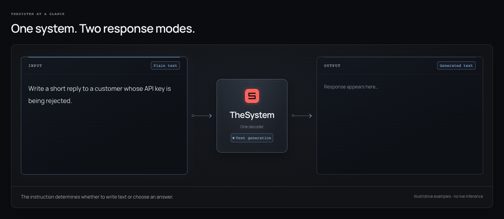
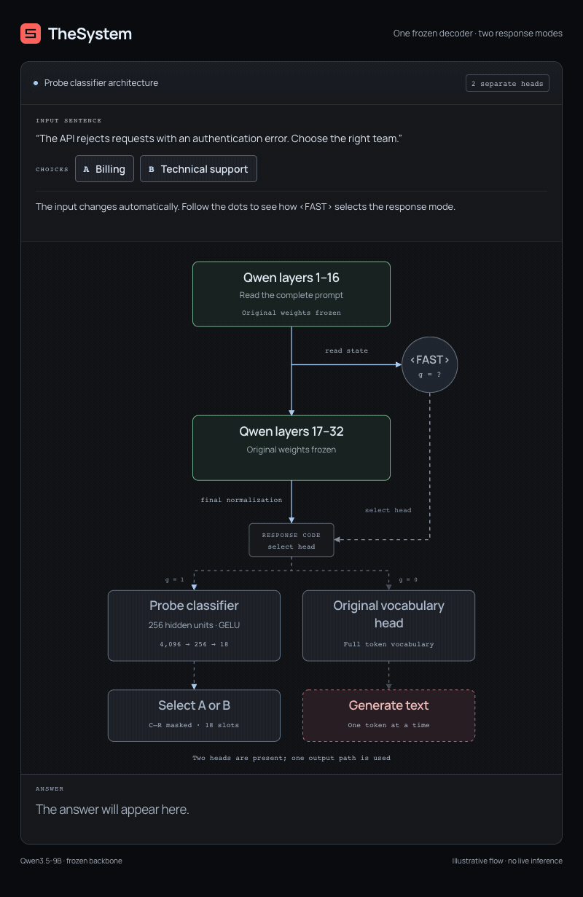
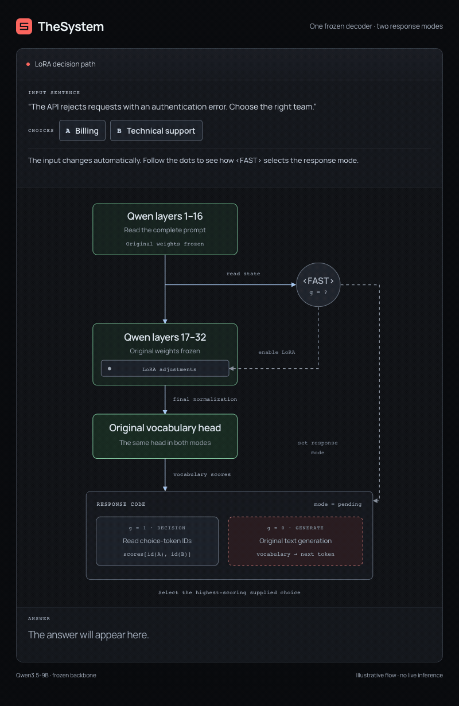

#  TheSystem

AI from Poland 

**Use one model to make decisions and generate text.**

Give TheSystem a set of options to choose from, or ask it to write a reply or explanation.
TheSystem runs on Qwen3.5-9B and uses a learned **`<FAST>`** gate to choose between these two modes.
I built two versions, **Probe-256** and **LoRA**, both with the original text-generation path.

[Approach and technical details](https://github.com/bqpro1/TheSystem-Website) — the interactive architecture page and its local preview instructions.

For example: “Choose: Billing or Support” uses decision mode; “Write a reply” uses generation mode.

## Try it

Open either notebook in Colab and run the cells in order.

| Model | Try in Colab | Model on Hugging Face |
|---|---|---|
| Probe-256 | [Open notebook](https://colab.research.google.com/github/bqpro1/TheSystem/blob/main/notebooks/01-Try-Probe-256.ipynb) | [TheSystem-9B-Probe-256](https://huggingface.co/Lbuk/TheSystem-9B-Probe-256) |
| LoRA | [Open notebook](https://colab.research.google.com/github/bqpro1/TheSystem/blob/main/notebooks/02-Try-LoRA.ipynb) | [TheSystem-9B-LoRA](https://huggingface.co/Lbuk/TheSystem-9B-LoRA) |

> **Let the model choose the mode, or set it yourself.** Use `mode="auto"` for automatic routing. To run in **decision-only mode**, pass `mode="decision"` and the answer choices on every request. Use `mode="generation"` for writing.

Requires an NVIDIA GPU with native BF16 support. Repositories are currently private;
see [setup and private access](docs/REPRODUCIBILITY.md#setup-and-private-access).

<table>
  <tr>
    <td width="50%" align="center" valign="middle">
      
    </td>
    <td width="50%" valign="middle">
      <h3>&lt;FAST&gt; + Probe-256</h3>
      
<code>&lt;FAST&gt;</code> sends decisions to a classifier with one 256-unit hidden layer.

      
Writing uses Qwen’s original output head; the backbone stays frozen.

    </td>
  </tr>
  <tr>
    <td width="50%" valign="middle">
      <h3>&lt;FAST&gt; + LoRA</h3>
      
<code>&lt;FAST&gt;</code> enables small LoRA adjustments for decisions and bypasses them for writing.

      
Both modes use Qwen’s original output head; its base weights stay frozen.

    </td>
    <td width="50%" align="center" valign="middle">
      
    </td>
  </tr>
</table>

*Illustrative flows. Select a schematic to view it at full size.*

## Abstract

Decision models based on decoder-only LLMs are designed to select answers from a given set
([Nimble](https://github.com/bespokelabsai/nimble), [Jev](https://typesafe.ai/blog/introducing-system-one-models-and-jev)).
However, adapting an LLM for decisions changes its generative behavior. This can lead to using
one model for decisions and another for text generation.

Decision models invite an analogy with System One, in contrast to System Two. In the account
popularized by Daniel Kahneman in [*Thinking, Fast and Slow*](https://us.macmillan.com/books/9780374275631/thinkingfastandslow/),
System One is quick and automatic, while System Two involves slower, deliberate reasoning.
Yet both coexist within one system of human cognition. I explored a similar idea for decoder-only LLMs.

I built **TheSystem**, whose learned internal gate, **`<FAST>`**, chooses once per prompt
between selecting a supplied answer and using the model’s original text-generation path.
Training has two separate objectives: teaching the gate to distinguish decision prompts from
generative prompts, and teaching the model to select answers. The decision path can use either
[LoRA adjustments](https://arxiv.org/abs/2106.09685) or a [probe classifier](https://arxiv.org/abs/1610.01644)
that reads the frozen backbone’s internal state. I tested both architectures.

The purpose of this release is to show that decisions and text generation can be performed
by one LLM with a **`<FAST>`** gate. TheSystem uses [Qwen3.5-9B](https://huggingface.co/Qwen/Qwen3.5-9B)
as the frozen backbone. In generation mode, the learned decision components are bypassed,
and the original model generates the response. I turned off Qwen’s native thinking mode
(`enable_thinking=False`) for all release tests of the original backbone, Probe-256 and LoRA.
In the next release, I plan to publish results from experiments with Qwen’s thinking mode
enabled for text generation.

## Research

[Open the validation notebook in Colab](https://colab.research.google.com/github/bqpro1/TheSystem/blob/main/notebooks/03-Reproduce-Evaluation.ipynb) to compare original Qwen, Probe-256 and LoRA on five benchmarks and check routing and writing preservation.

[Run the evaluation and read your results](docs/EVALUATION.md) · [Datasets](https://huggingface.co/datasets/Lbuk/TheSystem-Data) · [Licences](licenses/README.md)

## License

TheSystem’s original code and learned weights are available under the [Apache License 2.0](LICENSE).
See [Licences and attribution](licenses/README.md) for third-party code, models and datasets.

## Cite this work

Leszek Bukowski (2026). *TheSystem* (version 0.1.0rc4). [GitHub repository](https://github.com/bqpro1/TheSystem).
